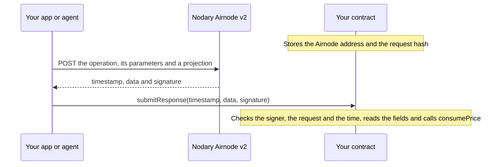

# AirnodeHub hackathon starter template

Bring signed API data into your contract. This template fetches an ETH/USD price that the
[Nodary](https://airnodehub.api3.org/explore/nodary) Airnode v2 signed, verifies the signature on-chain and reads the
price out of the signed JSON. Copy the two libraries in `contracts/` into your project, or fork the repo and inherit
from `NodaryPriceConsumer`.

Everything here is for Airnode v2, the version of Airnode that serves the APIs on AirnodeHub.

## How it works



1. **Pick the request before any data exists.** The request is an operation, its parameters and a projection. Its hash
   depends only on these, so you compute it off-chain (`pnpm request-hash`) and store it in the contract together with
   the address that the Airnode signs with.
2. **Fetch a signed response.** The projection cuts Nodary's response down to the two fields that the contract needs:

   ```sh
   curl --request POST https://airnode-nodary.fly.dev/ \
     --header 'Content-Type: application/json' \
     --data '{
       "operation": "latestFeeds",
       "parameters": { "name": "ETH/USD" },
       "responseProjection": { "price": "/ETH~1USD/value", "updatedAt": "/ETH~1USD/timestamp" }
     }'
   ```

   This response is real, so you can test your own verifier with it:

   ```json
   {
     "airnode": "0xE70f1e8b22a21e4Bb5188918a3033341b281E4c0",
     "requestHash": "0x180eae9387bb66a72380e61ebe0a00d19f8414a716a37ebe1df124b66acfff66",
     "timestamp": "1792403240",
     "data": { "price": 2443.95, "updatedAt": 1792403240691 },
     "signature": "0xb034c17a11679ff06e50445c84419c34ba0aee5669bbda3a0dd563d2437928a17e5b34826fd505b0d1cace3712570df07de0d0a7eb2e1610c84cd4a0d71827e21b"
   }
   ```

3. **Submit it.** Anyone can send `timestamp`, `data` and `signature` to the contract: a user, a keeper bot or an agent.
   `data` goes in as the bytes of its compact JSON, `{"price":2443.95,"updatedAt":1792403240691}`, which is exactly what
   the Airnode signed. `JSON.stringify(response.data)` gives you these bytes.
4. **The contract checks the response, then reads it.** From
   [`NodaryPriceConsumer`](contracts/examples/NodaryPriceConsumer.sol):

   ```solidity
   AirnodeV2Attestation.verify(AIRNODE_V2, requestHash, timestamp, data, signature);
   if (timestamp + MAX_RESPONSE_AGE < block.timestamp) revert ResponseTooOld(timestamp);
   uint256 price = ProjectedJson.readUint(data, "price", 18);
   uint256 priceTimestamp = ProjectedJson.readUint(data, "updatedAt", 0) / 1000;
   if (priceTimestamp + MAX_PRICE_AGE < block.timestamp) revert PriceTooOld(priceTimestamp);
   consumePrice(price, priceTimestamp);
   ```

5. **Your contract uses the price.** `NodaryPriceConsumer` is abstract. Inherit from it and implement `consumePrice`,
   which runs only for a price that passed every check. [`NodaryPriceLogger`](contracts/examples/NodaryPriceLogger.sol)
   is the smallest implementation:

   ```solidity
   contract NodaryPriceLogger is NodaryPriceConsumer {
       event PriceConsumed(uint256 price, uint256 priceTimestamp);

       constructor(bytes32 requestHash_) NodaryPriceConsumer(requestHash_) {}

       function consumePrice(uint256 price, uint256 priceTimestamp) internal override {
           emit PriceConsumed(price, priceTimestamp);
       }
   }
   ```

## Quick start

You need [Foundry](https://getfoundry.sh), [Node.js](https://nodejs.org) 22.18 or later and [pnpm](https://pnpm.io).

```sh
git clone --recurse-submodules https://github.com/api3dao/airnodehub-hackathon.git
cd airnodehub-hackathon/starter
pnpm install
forge test
pnpm test
```

To run the whole flow on a local chain, start `anvil` in one terminal, then run this in another:

```sh
cp .env.example .env
REQUEST_HASH=$(pnpm --silent request-hash) forge script script/DeployNodaryPriceLogger.s.sol \
  --rpc-url http://127.0.0.1:8545 --broadcast
pnpm submit-response
```

`submit-response` fetches a fresh response, checks it off-chain, sends it to the contract and prints the price from the
`PriceConsumed` event:

```
Submitted {"price":2421.42,"updatedAt":1792411032300} in transaction 0xdd98d5fd18692ddef6ab7ff8f07d31d1ff8cf14ed88521f8380eb5a8c9df4939
The contract consumed the ETH/USD price 2421.42, taken at 2026-10-19T11:57:12.000Z
```

To deploy on a testnet, put your own `PRIVATE_KEY` and `RPC_URL` in `.env`, run the deploy command with your RPC URL
after `--rpc-url`, and set `CONSUMER_ADDRESS` to the address that the script prints.

| Command                            | What it does                                                                         |
| ---------------------------------- | ------------------------------------------------------------------------------------ |
| `pnpm request-hash [feed name]`    | Prints the request hash, without calling the Airnode.                                |
| `pnpm fetch-response [feed name]`  | Fetches a signed response, checks it and prints it with `data` as the signed string. |
| `pnpm submit-response [feed name]` | Fetches a signed response, checks it and submits it to `CONSUMER_ADDRESS`.           |

The feed name is `ETH/USD` unless you give another one, such as `BTC/USD`. Deploy and submit with the same feed. To see
every feed that Nodary serves, call `latestFeeds` without parameters.

## What is in the template

| Path                                                                                       | What it is                                                                                                                           |
| ------------------------------------------------------------------------------------------ | ------------------------------------------------------------------------------------------------------------------------------------ |
| [`contracts/AirnodeV2Attestation.sol`](contracts/AirnodeV2Attestation.sol)                 | `verify` reverts unless the Airnode signed the data as its response to the request. `recoverSigner` returns the signer.              |
| [`contracts/ProjectedJson.sol`](contracts/ProjectedJson.sol)                               | `readUint`, `readInt`, `readBool` and `readString` read a top-level field of the signed JSON by its name, with Solady's JSON parser. |
| [`contracts/examples/NodaryPriceConsumer.sol`](contracts/examples/NodaryPriceConsumer.sol) | Abstract contract that checks a signed Nodary response, reads the price and passes it to `consumePrice`.                             |
| [`contracts/examples/NodaryPriceLogger.sol`](contracts/examples/NodaryPriceLogger.sol)     | Implements `consumePrice` by emitting an event. Replace the event with your own logic.                                               |
| [`script/DeployNodaryPriceLogger.s.sol`](script/DeployNodaryPriceLogger.s.sol)             | Deploys `NodaryPriceLogger`.                                                                                                         |
| [`src/airnode-v2.ts`](src/airnode-v2.ts)                                                   | `deriveRequestHash`, `fetchSignedResponse` and `verifySignedResponse`, for your app or agent.                                        |
| [`src/nodary.ts`](src/nodary.ts)                                                           | The Nodary Airnode's URL and address, and the request with its projection.                                                           |
| [`test/`](test)                                                                            | Tests, including the tamper test. [`test/fixtures`](test/fixtures) holds real signed responses that `pnpm fetch-response` saved.     |

## The three checks

The [tamper test](https://api3dao.github.io/airnodehub-hackathon/#judging) of the hackathon sends your contract a real
response with an edited value, a real response that is too old, a real response to a different request and a response
signed with the wrong key. The example contract rejects all four ([tests](test/NodaryPriceConsumer.t.sol)), because it
checks three things:

- **The signer.** Compare the recovered address with an Airnode address that your contract stores. Never trust the
  `airnode` field or the `X-Airnode-Address` header, because whoever forges a response sets those too. The Airnode's
  address is in the `x-airnode` extension of the document that a `GET` of its URL returns.
- **The request.** The request hash covers the operation, its parameters and the projection. `verify` puts the stored
  hash into the digest, so a real response to another request, such as another feed, flight or city, recovers a
  different signer. If your contract handles many requests, such as one for each bet, store a hash when you create each
  bet.
- **The time.** `timestamp` is when the Airnode signed. The signature covers it, so you can trust it after `verify`.
  Decide what fresh means for your contract. Anyone can submit the same response again, and `NodaryPriceConsumer`
  leaves that to `consumePrice`: accept only a price that is newer than the last one, or let each bet settle only once.

The data can have its own timestamp, such as Nodary's `updatedAt`. It tells you how old the value was when the Airnode
signed it. A fresh signature can cover an old value. For example, Nodary updates the ankrETH/ETH exchange rate about
once a day, so a response that the Airnode signed a second ago can carry a value that is a day old
([test](test/NodaryPriceConsumer.t.sol)). Check both timestamps when the age of the value matters.

## Projections

A projection maps field names that you choose to [JSON Pointers](https://datatracker.ietf.org/doc/html/rfc6901) into
the full response. A pointer writes `/` in a key as `~1` and `~` as `~0`, so the key `ETH/USD` becomes `/ETH~1USD`.

- **The projection is signed.** The request hash includes it, and the signed `data` is the projected object. So a
  contract that stores the request hash knows which fields `data` has.
- **The request hash does not fix the field order.** The request hash sorts the fields, but `data` keeps the order of
  the request. So `{"price":…,"updatedAt":…}` and `{"updatedAt":…,"price":…}` both pass `verify` with the same request
  hash. `ProjectedJson` finds fields by name, so either order works. Do not read fields by their position.
- **Project single values.** `ProjectedJson` reads numbers, strings and booleans in top-level fields. To read inside a
  projected object, use Solady's `JSONParserLib` directly, such as
  `JSONParserLib.parse(string(data)).at('"feed"').at('"value"')`.
- **A pointer to a field that is not there fails.** The Airnode answers with `400` and signs nothing, so you cannot get
  a signed proof that a field is missing.
- **A pointer reaches array elements only by index**, such as `/flights/0/status`. Make sure that the upstream API
  keeps the order of the array stable.

The [passthrough](https://airnodehub-docs.api3.org/airnode/http-interface) takes the same projection as query
parameters (`x-airnode-project=price:/ETH~1USD/value`). It returns the signature in `X-Airnode-*` headers and the
projected JSON as the body, which is `data`. It derives the request hash in a different way, so a contract that stores
one hash accepts responses from only one of the two routes. The
[attestation docs](https://airnodehub-docs.api3.org/airnode/attestation) describe both.

## Reading the data on-chain

`ProjectedJson` parses the data with Solady's
[`JSONParserLib`](https://github.com/Vectorized/solady/blob/v0.1.26/src/utils/JSONParserLib.sol) and turns decimal
numbers into integers with the number of decimals that you ask for:

| Signed data             | Call                              | Result                               |
| ----------------------- | --------------------------------- | ------------------------------------ |
| `{"price":2443.95}`     | `readUint(data, "price", 18)`     | `2443950000000000000000`             |
| `{"price":2443.959}`    | `readUint(data, "price", 2)`      | `244395`, the extra digit is cut off |
| `{"price":0.00000012}`  | `readUint(data, "price", 18)`     | `120000000000`                       |
| `{"temperature":-12.5}` | `readInt(data, "temperature", 1)` | `-125`                               |
| `{"isFinal":true}`      | `readBool(data, "isFinal")`       | `true`                               |
| `{"status":"Landed"}`   | `readString(data, "status")`      | `"Landed"`                           |

- **Verify before you read.** Only the signature makes the data trustworthy. Invalid JSON reverts with
  `JSONParserLib.ParsingFailed`, a missing field with `FieldNotFound` and a value of the wrong type with
  `UnexpectedValue`.
- **Compare strings by their hash**, such as
  `keccak256(bytes(ProjectedJson.readString(data, "status"))) == keccak256("Landed")`. With a projection of one field,
  you can also skip the parser and compare `keccak256(data)` with the hash of each outcome that you expect.
- **Large integers lose precision before they are signed.** The Airnode signs numbers as JavaScript doubles, which keep
  about 15 significant digits. For a value that must be exact, such as an amount in wei, project a field that the API
  sends as a string, read it with `readString` and parse the digits.
- **Gas and size.** Reading a field costs about 17,000 gas, because each read parses the whole object. `submitResponse`
  in the example costs about 63,000 gas, plus whatever `consumePrice` does. The two libraries add about 6 KB to a
  contract, a quarter of the 24 KB limit.

## Use another API

1. Find a listing on [AirnodeHub](https://airnodehub.api3.org), or connect your agent to the MCP server at
   `https://airnodehub.api3.org/mcp` and use `search-listings`. A `GET` of the Airnode's URL returns its operations,
   their parameters and the address that it signs with.
2. Call the operation once without a projection to see the full response. Then write a pointer for each field that your
   contract needs.
3. Build the request the way [`buildPriceRequest`](src/nodary.ts) does, and compute its hash with
   [`deriveRequestHash`](src/airnode-v2.ts). Every response to that request carries the same `requestHash`, so you can
   also copy it from one call.
4. In your contract, store the Airnode address and the request hash, and keep the checks of
   [`submitResponse`](contracts/examples/NodaryPriceConsumer.sol).

## Good to know

- **Someone has to bring the data.** A contract cannot call an API, so whoever benefits submits the response. If, for
  example, an insurance policy should expire without a payout, give it a deadline after which the funds go back.
- **Look out for cherry-picking.** For a value that moves, such as a price, a submitter can fetch many responses and
  submit the best one that is still fresh. Make the time window narrow, for example by accepting only responses signed
  in the first minutes after expiry. A fact such as a match result does not have this problem.
- **Nodary runs its own Airnode.** For the other listings, API3 runs the Airnode, and the signature attests to what the
  provider's API returned to it.
- **All teams share the upstream quotas.** Cache responses, and do not poll in a loop.

## Links

- [The hackathon challenge](https://api3dao.github.io/airnodehub-hackathon/)
- [AirnodeHub](https://airnodehub.api3.org)
- [Documentation](https://airnodehub-docs.api3.org)
- [Verifying a signature](https://airnodehub-docs.api3.org/airnode/attestation)
- [Calling an Airnode, projections and payments](https://airnodehub-docs.api3.org/airnode/http-interface)
- [API3 Discord](https://discord.gg/api3dao)
